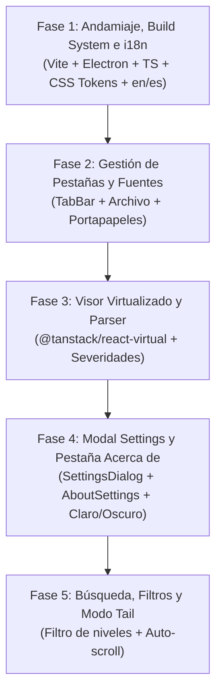

# Propuesta Inicial y Especificación de MVP: Hyper-Logviewer

Visor de archivos `.log` de alto rendimiento y experiencia de usuario moderna basada en la interfaz y arquitectura de **Morrow**.

---

## 1. Resumen Ejecutivo

**hyper-logviewer** es una aplicación de escritorio *local-first* diseñada para la visualización, filtrado y diagnóstico ultrarrápido de registros de depuración y auditoría (`.log`). Tomando como base visual y arquitectónica el proyecto **Morrow** (`D:\Proyectos-Aplicaciones\NodeJS\Morrow`), el visor adopta su andamiaje moderno (**Electron + React 19 + TypeScript + Vite**), su sistema de estilos mediante tokens y variables CSS puras (temas Claro y Oscuro con paletas de acento), su patrón de configuración modal desacoplado (`SettingsDialog`) y su sistema de navegación por pestañas (`TabBar`), adaptándolos específicamente al procesamiento eficiente de grandes flujos de datos.

El proyecto incorpora un motor de internacionalización (**i18n**) nativo y tipado con **inglés como idioma predeterminado** y **español completamente soportado**, y mantiene la pestaña **Acerca de** (*About*) dentro del modal de configuración.

---

## 2. Puntos Clave de la Experiencia de Usuario (GUI & UX)

Inspirado en la ergonomía de **Morrow**, hyper-logviewer ofrece:
* **Internacionalización Bilingüe (i18n):**
  * Idioma predeterminado: **Inglés (`en`)**.
  * Idioma secundario integrado: **Español (`es`)**.
  * Conmutación instantánea desde el modal de ajustes sin necesidad de reiniciar la aplicación.
* **Estilo Visual Limpio y Bimodal:** Soporte nativo para modo Claro (`data-theme="light"`), modo Oscuro (`data-theme="dark"`) y seguimiento automático del tema del sistema operativo, con colores de acento personalizables (Ember, Ocean, Aqua, Violet).
* **Modal de Configuración Flotante:** Idéntico al diseño de Morrow, con categorías a la izquierda:
  * `General`: Idioma (`en` / `es`), codificación por defecto, límites de buffer.
  * `Appearance`: Tema, acento, tipografía monoespaciada, tamaño de fuente.
  * `Parser`: Detección de niveles de severidad y marcas de tiempo.
  * `Shortcuts`: Lista de atajos de teclado.
  * `About` (**Acerca de**): Muestra el logotipo de la aplicación, versión, descripción, botón de atajos, enlace al repositorio en GitHub y créditos de código abierto.
* **Sistema de Pestañas Multi-log:** Pestañas superiores con scroll horizontal, cierre individual, atajos rápidos (`Ctrl+T`, `Ctrl+W`, `Ctrl+1..9`) y menú contextual para duplicar o cerrar pestañas secundarias.
* **Triple Mecanismo de Entrada:**
  1. *Explorador de Archivos:* Diálogo nativo del sistema operativo (`Ctrl+O`).
  2. *Arrastrar y Soltar (Drag & Drop):* Zona activa central en estado inicial y arrastre continuo sobre la barra de pestañas para abrir múltiples archivos simultáneamente.
  3. *Inserción desde el Portapapeles (Clipboard Paste):* Botón directo y atajo global `Ctrl+V` que genera una nueva pestaña en memoria con el contenido crudo formateado y numerado.

---

## 3. Arquitectura del Sistema

```
+-------------------------------------------------------------------------+
|                              Electron                                   |
|   Proceso Principal (main.cts)  <== IPC (preload.cts) ==>  Renderer UI  |
+-------------------------------------------------------------------------+
|                                    |                                    |
|   - Gestión de ventanas nativas    |   - React 19 + TypeScript          |
|   - Diálogos showOpenDialog        |   - Tokens CSS (color.css / tokens)|
|   - Streaming y lectura en chunks  |   - TabBar (pestañas reactivas)    |
|   - Acceso seguro al portapapeles  |   - VirtualLogView (windowing)     |
|                                    |   - SettingsDialog (modal Morrow)  |
|                                    |   - AboutSettings (pestaña Acerca) |
|                                    |   - i18n Engine (en/es tipado)     |
|                                    |   - Parser de Severidades          |
+-------------------------------------------------------------------------+
```

### Componentes de Morrow Reutilizados vs. Adaptados

| Componente | Enfoque en Morrow | Adaptación en hyper-logviewer |
| :--- | :--- | :--- |
| **Tokens CSS** | `tokens.css`, `color.css` | Reutilizado al 100% para preservar la paleta, radios y sombras exactas. |
| **Modal Settings** | `SettingsDialog.tsx` | Reutilizado con secciones: General, Apariencia, Parser, Atajos y Acerca de. |
| **Pestaña Acerca de** | `AboutSettings.tsx` | Conservada con versión, logo SVG, enlaces de GitHub y atajos. |
| **Motor i18n** | `src/app/i18n/` | Reutilizado el motor sin dependencias con `en` por defecto y `es` completo. |
| **Navegación** | `TabBar.tsx` + `tabs.ts` | Adaptado para manejar archivos en disco y buffers efímeros del portapapeles. |
| **Motor de Texto** | Tiptap (Markdown WYSIWYG) | **Sustituido** por un visor virtualizado `@tanstack/react-virtual` para soportar millones de líneas a 60 FPS sin colapsar memoria. |
| **Iconografía** | Lucide React | **Sustituido** por [Tabler Icons](https://tabler.io/icons) (`@tabler/icons-react`) con trazo uniforme (`stroke={1.5}`) y amplia cobertura de glifos. |
| **Lógica de Datos** | Vault de archivos Markdown | **Sustituido** por un analizador de líneas de log (extracción de nivel de log, marcas de tiempo y texto). |

---

## 4. Especificación Funcional del MVP

### 4.1 Carga de Archivos
* Apertura mediante botón «Abrir archivo» / «Open file» o atajo `Ctrl+O`.
* Arrastre y soltar (*drag & drop*) tanto en la zona vacía como directamente en el `TabBar`.
* Manejo de rutas y metadatos de archivo (nombre, tamaño en KB/MB, ruta absoluta para recarga).

### 4.2 Portapapeles Instantáneo
* Detección de atajo `Ctrl+V` o botón «Pegar log» / «Paste log» en la barra superior.
* Genera una nueva pestaña en memoria identificada como `Clipboard #1` / `Portapapeles #1`.
* Procesamiento inmediato de líneas, niveles de severidad y recuento total.

### 4.3 Visor de Alto Rendimiento (Virtualización)
* Renderizado únicamente de las filas visibles en pantalla (evita crear miles de nodos en el DOM).
* Resaltado sintáctico de niveles de severidad:
  * `FATAL` / `ERROR`: Rojo distintivo (`var(--danger)`).
  * `WARN`: Amarillo advertencia (`var(--mark)`).
  * `INFO`: Color de acento (`var(--accent)`).
  * `DEBUG` / `TRACE`: Atenuado (`var(--text-faint)`).
* Numeración de línea alineada a la izquierda (gutter monoespaciado fijo).

### 4.4 Filtrado y Búsqueda
* Campo de búsqueda rápida con soporte para texto simple o expresiones regulares (regex).
* Chips de filtrado interactivo para alternar la visualización por nivel (`ERROR`, `WARN`, `INFO`, `DEBUG`).
* Resaltado en tiempo real de términos coincidentes.

### 4.5 Modal de Configuración y Pestaña Acerca de
* Modal flotante con desenfoque de fondo y cierre mediante `Escape` o clic exterior.
* Opciones:
  * **General:** Idioma (`English` / `Español`), límite de buffer para pegado rápido.
  * **Apariencia:** Tema (Claro / Oscuro / Sistema), acento de color, tipografía monoespaciada, tamaño de fuente y ajuste de línea (*word wrap*).
  * **Parser:** Reglas y patrones de severidad.
  * **Atajos:** Guía visual de combinaciones de teclas.
  * **Acerca de (`About`):** Identidad gráfica, versión actual, créditos y enlace al repositorio de código fuente.

---

## 5. Flujo Git, Convención de Commits y Directivas de Agentes

### 5.1 Modelo de Ramas
* **`main`:** Rama de producción y versiones estables.
* **`dev`:** Rama activa de desarrollo e integración principal.
* **`feature/<nombre>`:** Ramas de características específicas desprendidas de `dev`.

### 5.2 Estándar Open Source de Commits
Formato estricto: `<sustantivo> : <verbo> <descripción>`
* **Autor / Maintainer:** En **español** (ej. `visor : integrar virtualización con tanstack`, `i18n : agregar diccionario en español`).
* **Comunidad / Open Source:** En **inglés** (ej. `viewer : integrate virtualized scrolling`, `tabs : add horizontal navigation`).

### 5.3 Carpeta Local `docs/`
* Excluida expresamente del control de versiones (`.gitignore`).
* Destinada a logs de prueba, benchmarks, especificaciones o notas temporales del usuario y los agentes de IA.

### 5.4 Documentación para Agentes (en inglés)
* [`AGENTS.md`](file:///D:/Proyectos-Aplicaciones/NodeJS/hyper-logviewer/AGENTS.md): Reglas de operación, flujo de ramas y directivas para agentes.
* [`AGENTS_STYLE_GUIDE.md`](file:///D:/Proyectos-Aplicaciones/NodeJS/hyper-logviewer/AGENTS_STYLE_GUIDE.md): Estándar estricto de TypeScript, React 19, tokens CSS, Tabler Icons e i18n.

---

## 6. Hoja de Ruta de Implementación (Roadmap)



1. **Fase 1: Andamiaje, Infraestructura Base e i18n**
   - Configuración de `package.json`, `tsconfig.json`, `vite.config.ts`, `vite.electron.config.ts`.
   - Estructura Electron: `electron/main.cts` y `electron/preload.cts`.
   - Traslado y adaptación de variables CSS: `tokens.css`, `color.css`, `app.css`.
   - Integración de la librería de iconos [Tabler Icons](https://tabler.io/icons) (`@tabler/icons-react`).
   - Motor `src/app/i18n/` con diccionarios tipados `en.ts` (por defecto) y `es.ts`.
2. **Fase 2: Pestañas y Mecanismos de Entrada**
   - Implementación del store reactivo de pestañas (`tabs.ts`).
   - Componente `TabBar.tsx` con soporte para arrastrar y soltar.
   - Integración de apertura nativa de archivos y pegado desde portapapeles.
3. **Fase 3: Visor Virtualizado y Parser de Logs**
   - Componente `VirtualLogViewer.tsx` con `@tanstack/react-virtual`.
   - Parser de severidad (`parser.ts`) y formateo de líneas.
4. **Fase 4: Configuración Modal y Pestaña Acerca de**
   - Implementación de `SettingsDialog.tsx` con componentes `primitives.tsx` (Dialog, Switch, Segmented, Select).
   - Componente `AboutSettings.tsx` con logotipo, versión y enlaces.
   - Selector dinámico de idioma (`en`/`es`), temas y acentos de color.
5. **Fase 5: Filtrado Dinámico y Modo Tail**
   - Barra de búsqueda y chips de severidad activos.
   - Modo seguimiento automático (*Tail/Follow*).
